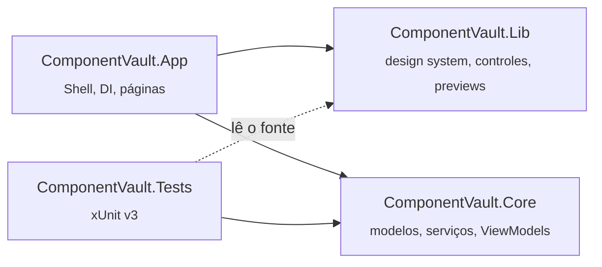

<div align="center">

# ComponentVault

**Uma vitrine viva de componentes .NET MAUI: do controle cru ao acabado, lado a lado.**

[](https://github.com/Azincourt-tech/ComponentVault/actions/workflows/ci.yml)
[](https://dotnet.microsoft.com/)
[](https://learn.microsoft.com/dotnet/maui/)
[](https://learn.microsoft.com/dotnet/csharp/)
[](#começando)
[](LICENSE)


[Níveis](#os-quatro-níveis) ·
[Catálogo](#catálogo) ·
[Design system](#design-system) ·
[Bibliotecas](#bibliotecas) ·
[Arquitetura](#arquitetura) ·
[Começando](#começando) ·
[Roadmap](ROADMAP.md)

</div>

---

## Sobre

O ComponentVault mostra, para cada componente de interface, **até onde dá para levar o .NET MAUI**. Em vez de um catálogo de prints, cada exemplo é código de verdade, rodando no app, com o snippet extraído do próprio fonte. O snippet nunca diverge do que está na tela.

Cada componente tem quatro abas:

| Aba | O que tem |
|---|---|
| **Preview** | O componente funcionando, para tocar, digitar e arrastar. |
| **Lado a lado** | Todos os níveis juntos, para comparar de relance. |
| **Docs** | Propriedades, quando usar, limitações e as decisões de design e usabilidade. |
| **Código** | O XAML e o C# com realce de sintaxe e botão de copiar. |

E um modo **Apresentar**, em tela cheia, que troca de nível com as setas do teclado ou deslizando o dedo.

## Os quatro níveis

| | Nível | O que mostra |
|:---:|---|---|
|  | **Base MAUI** | O controle cru, sem nenhum estilo: o que a plataforma entrega. |
|  | **Estilizado** | O mesmo controle levado ao limite com os tokens do design system. |
|  | **Custom** | Desenhado à mão, com Microsoft.Maui.Graphics, SkiaSharp e handlers. |
|  | **Biblioteca** | Feito com libs livres do ecossistema. Quando mais de uma lib tem o componente, cada uma ganha a sua aba. |

A cor de cada nível é a mesma em todo o app: no seletor de nível, nos selos, na legenda da Home e no modo Apresentar.

## Catálogo

| Categoria | Componentes |
|---|---|
| **Ações** | Button, Chips |
| **Entradas** | Entry, Editor, SearchBar, Stepper, Código OTP, Picker, DatePicker |
| **Seleção** | Switch, CheckBox, RadioButton, Slider, Segmented control, Rating |
| **Feedback** | Progress, Skeleton, Alert, Toast, Empty state |
| **Exibição** | Badge, Avatar, Ícones |
| **Contêineres** | Glass, Card, List, Carousel |
| **Navegação** | Tabs, Popup |
| **Dados** | Chart |

Mídia e documentos (player de vídeo e áudio, PDF, imagem e galeria) estão no [roadmap](ROADMAP.md#mídia-e-documentos).

## Design system

### Temas

Três temas trocáveis ao vivo, pela barra de navegação:

| Tema | Visual |
|---|---|
| **Claro "Pérola"** | Fundo perolado, cards de metal claro com aresta em bronze e um brilho de pôr do sol suave ao fundo. |
| **Escuro** | Fundo Ink Black, cards de metal noturno e brilho de brasa atrás do conteúdo. |
| **Vidro** | Superfícies translúcidas sobre luzes vivas, inspirado no Liquid Glass da Apple. |

O fundo é uma **galáxia animada**: manchas de luz que fluem como líquido e um campo de estrelas que pisca e gira devagar. É mais forte no Vidro e contido nos outros dois.

### Paleta "Fiery Red Sunset"


O destaque é o **Cayenne `#E85D04`**, de propósito longe do azul nativo do Windows e do Android, para o nível Estilizado se separar do Base à primeira vista.

### Princípios

- **Uma cor de destaque**, usada com intenção nos pontos de ação e estado; o resto é neutro.
- **Linhas finas no lugar de sombras**, tinta quase preta e corpo de 16px.
- **Tipografia:** Plus Jakarta Sans para a interface e JetBrains Mono para código.
- **Movimento curto:** press de 90ms, transição de página com elemento compartilhado (Hero) e entrada em cascata nas listas.
- **Responsivo pela largura, não pelo aparelho:** três faixas (compacta, média e expandida) que mudam ao vivo quando a janela muda de tamanho.
- **Estilos sempre nomeados**, nunca implícitos, para o nível Base continuar cru.

As cores trocáveis ficam em três paletas com as mesmas chaves, consumidas por `{DynamicResource}`. Um teste garante que as três têm as mesmas chaves e que toda chave usada no XAML existe.

## Bibliotecas

Só entram libs **100% livres** (MIT ou equivalente, sem cadastro nem chave) e com build para **.NET 10**.

| Biblioteca | Licença | Usada em |
|---|---|---|
| [Syncfusion Toolkit](https://github.com/syncfusion/maui-toolkit) | MIT | Button, Card, Accordion, Carousel, Chart, Chips, DatePicker, Entry, List, OTP, Picker, Popup, Progress, Segmented, Skeleton, Stepper, Tabs |
| [UraniumUI](https://github.com/enisn/UraniumUI) | MIT | Button, CheckBox, DatePicker, Entry, Picker, RadioButton, SearchBar, Tabs |
| [CommunityToolkit.Maui](https://github.com/CommunityToolkit/Maui) | MIT | Avatar, Card (Expander), Popup, Toast |
| [Sharpnado.Tabs](https://github.com/roubachof/Sharpnado.Tabs) | MIT | Tabs, Segmented |
| [LiveCharts2](https://github.com/beto-rodriguez/LiveCharts2) | MIT | Chart |
| [Microcharts](https://github.com/microcharts-dotnet/Microcharts) | MIT | Chart (minigráficos) |
| [Plugin.Maui.Calendar](https://github.com/yurkinh/Plugin.Maui.Calendar) | MIT | DatePicker (agenda com eventos) |
| [MauiIcons](https://github.com/AathifMahir/MauiIcons) | MIT | Ícones (Fluent) |
| [SkiaSharp](https://github.com/mono/SkiaSharp) | MIT | Desenho dos níveis Custom |
| [CommunityToolkit.Mvvm](https://github.com/CommunityToolkit/dotnet) | MIT | ViewModels |

> O **Syncfusion Toolkit** é o toolkit open source do Syncfusion, diferente da linha paga: não pede chave de licença.

## Arquitetura



```
src/
  ComponentVault.Core    net10.0 puro: modelos, serviços, ViewModels (sem MAUI)
  ComponentVault.Lib     design system (tokens, paletas, estilos), controles e previews
  ComponentVault.App     app MAUI: Shell, DI, páginas
tests/
  ComponentVault.Tests   serviços, ViewModels e consistência do catálogo com o código
```

- **Snippets nunca divergem do código.** A Lib embute o próprio fonte como recurso, e o app extrai as regiões marcadas com `<!-- snippet:id -->` / `// snippet:id`.
- **Adicionar um componente** é criar o preview com `[ShowcasePreview("id")]` e uma entrada no `ComponentCatalog`. Um teste falha se um snippet ou preview citado não existir.
- **Core sem MAUI.** O compilador garante que nenhuma ViewModel referencie `Microsoft.Maui.*`, e os testes rodam sem o workload.

## Começando

### Requisitos

- SDK do **.NET 10** com o workload **MAUI**.
- No Windows: Visual Studio com "Desenvolvimento .NET Multiplataforma" e o Android SDK.

### Rodar

```powershell
dotnet test --project tests/ComponentVault.Tests
```

```powershell
dotnet build src/ComponentVault.App -f net10.0-windows10.0.19041.0 -t:Run
```

No Visual Studio, abra `ComponentVault.slnx` e rode o perfil **Windows Machine** ou um emulador Android.

### Variáveis de desenvolvimento

Úteis para abrir direto numa tela e para capturas automatizadas:

| Variável | Efeito |
|---|---|
| `COMPONENTVAULT_START` | Abre numa rota do Shell, ex.: `catalog` ou `catalog/component?id=switch`. Aceita `&variant=switch.styled`, `&present=true` e `&tab=compare\|docs\|code`. |
| `COMPONENTVAULT_THEME` | Força `Light`, `Dark` ou `Glass` nesta execução, sem salvar a preferência. |
| `COMPONENTVAULT_SIZE` | Abre a janela num tamanho, ex.: `390x844`, `768x1024` ou `1280x800`. |

No Windows, uma exceção não tratada é registrada em `%LOCALAPPDATA%\ComponentVault\crash.log`.

## Problemas conhecidos

- **Windows com leitor de tela.** Com MAUI 10.0.130 e Windows App SDK 1.8 (WinUI 3.1.8), qualquer página com `ScrollView` derruba o app (access violation em `Microsoft.UI.Xaml.dll`) quando a UI Automation percorre a árvore, como faz o Narrador. Reproduz num app MAUI vazio com um `ScrollView` e um `Label`, inclusive com o Windows App SDK self-contained. É bug do framework; acompanhar as próximas versões do MAUI e do Windows App SDK.
- **Android ainda não validado.** O build Android não coube no disco da máquina de desenvolvimento original. É o primeiro item do [roadmap](ROADMAP.md).

## Decisões (ADRs)

As decisões do PRD valem (CommunityToolkit.Mvvm, Lib separada, SQLite para preferências, Shell e `.resx`), com estes acréscimos:

| ADR | Decisão |
|---|---|
| **006** | **Core sem MAUI.** ViewModels e serviços num projeto `net10.0` puro: o compilador impede referências a `Microsoft.Maui.*` e os testes rodam sem workload. |
| **007** | **Aviso de cópia dentro do app.** No Windows, o Snackbar do CommunityToolkit vira notificação do sistema; o aviso "copiado" é um componente próprio na tela. |

## Contribuindo

Leia o [AGENTS.md](AGENTS.md) antes de mexer no código: ele traz o ambiente, as convenções de commit, o design system e as armadilhas já encontradas. O que falta fazer está no [ROADMAP.md](ROADMAP.md).

## Licença

Distribuído sob a licença [MIT](LICENSE).
